# TÀI LIỆU KIẾN TRÚC HỆ THỐNG (SYSTEM ARCHITECTURE)
## Nền tảng Khảo thí Trực tuyến An toàn & Giám sát AI (Smart AI Proctoring & Secure Examination Platform)

---

### 1. TỔNG QUAN HỆ THỐNG
Hệ thống là nền tảng khảo thí phân tán chuẩn Client-Server dành cho môi trường mạng nội bộ (LAN/Enterprise), tích hợp giám sát sinh trắc học thời gian thực bằng AI, kiểm soát an ninh tầng hệ điều hành (Kiosk OS-level), đồng bộ hóa lệnh thi đồng loạt qua UDP Multicast, và bảo đảm tính toàn vẹn, chống chối bỏ (Non-repudiation) thông qua Chữ ký số RSA-2048 PSS kết hợp hàm băm an toàn SHA-256.

---

### 2. SƠ ĐỒ THÀNH PHẦN KIẾN TRÚC PHÂN TẦNG (LAYERED SYSTEM COMPONENT DIAGRAM)

```mermaid
flowchart TB
    subgraph Presentation_Layer["1. TẦNG TRÌNH DIỄN (PRESENTATION LAYER)"]
        direction TB
        subgraph ClientDesktop["🖥️ CLIENT DESKTOP APPLICATION (PyQt6 Cyber Glassmorphism UI)"]
            subgraph UI_Layer["Giao diện Người dùng (QStackedWidget)"]
                S1["Screen 1: Pre-flight & LAN Discovery"]
                S2["Screen 2: Face ID & Biometric Login"]
                S3["Screen 3: Exam Paper & Question Palette"]
                S4["Screen 4: Cryptographic Receipt & QR Audit"]
            end

            subgraph Client_Security["An ninh Tầng Hệ điều hành (Win32 OS Hardening)"]
                VM["Anti-VM Detector (BIOS & MAC OUI)"]
                KB["Low-Level Keyboard Hook (WH_KEYBOARD_LL)"]
                DA["Display Affinity Guard (Anti-Screen Capture)"]
                MB["Multi-Monitor Blocker (QGuiApplication)"]
                PW["Anti-Cheat Watchdog (psutil 3s scan)"]
                AM["Audio Environmental Monitor (RMS > 3s)"]
            end

            subgraph Client_Proctor["Giám sát Thị giác AI (Multi-Modal Vision Engine)"]
                HUD["Cyber Camera HUD (L-Reticle, Gaze Ray, Laser Scan)"]
                EAR["Liveness & Blink Detector (EAR Spoof Guard)"]
                YOLO["Object Detector (Cell Phone & Person Count)"]
            end

            subgraph Client_Core["Tầng Xử lý Mạng & Lưu trữ Cục bộ"]
                Net_Client["NetworkClient (TCP Socket + RSA Signer)"]
                Local_DB[("Local SQLite Draft Storage")]
                MC_Listen["MulticastListener (UDP 224.1.1.1:5005)"]
                LAN_Scan["Client LAN Scanner (UDP 5006)"]
            end

            S3 <--> Local_DB
            HUD --> UI_Layer
            EAR --> HUD
            YOLO --> HUD
            Client_Security --> Net_Client
            HUD --> Net_Client
            MC_Listen --> S3
            LAN_Scan --> S1
        end

        subgraph ProctorWeb["🌐 PROCTOR WEB DASHBOARD (Zero-CDN Dark Mode SPA)"]
            Web_UI["Giao diện Giám thị: KPI Cards, Live Stream, Control Panel"]
            WS_Client["WebSocket Client (Live Violation & Candidates Feed)"]
            HTTP_Client["HTTP Fetcher (Snapshot Lightbox & Submissions)"]
            Web_UI <--> WS_Client
            Web_UI <--> HTTP_Client
        end
    end

    subgraph Transport_Layer["2. TẦNG GIAO VẬN MẠNG (NETWORK & TRANSPORT LAYER)"]
        TCP_Stream["Kênh TCP Tin cậy (Port 8888, 23-byte Binary Header + JSON Payload)"]
        WS_Stream["Kênh Real-time WebSocket (Port 8081 - Live Violation Push)"]
        HTTP_Stream["Kênh HTTP Server (Port 8080 - Static Dashboard & Evidence Snapshots)"]
        UDP_MC["Kênh UDP Multicast (224.1.1.1:5005 - Đồng bộ Lệnh thi Đồng loạt)"]
        UDP_Disc["Kênh UDP Broadcast Discovery (Port 5006 - Zero-Config LAN Pairing)"]
    end

    subgraph Backend_Layer["3. TẦNG BACKEND & DỊCH VỤ NGHIỆP VỤ (SERVER BUSINESS SERVICES)"]
        direction TB
        subgraph Server_Inbound["Tầng Điều phối Mạng & Cầu nối Web (Web Bridge)"]
            TCP_Listener["Multi-Thread TCP Listener (Port 8888)"]
            Socket_Handler["Socket Request Handler (Binary Router)"]
            Web_Bridge["ProctorWebBridge (HTTP 8080 + WebSocket 8081)"]
            MC_Sender["Multicast Command Broadcaster (TTL=2)"]
            Disc_Responder["Server Discovery Responder (UDP 5006)"]
        end

        subgraph Core_Services["Tầng Dịch vụ Nghiệp vụ (Business Services Layer)"]
            Session_Mgr["SessionManager (Heartbeat Watchdog & Active Pool)"]
            Auth_Svc["AuthService (Face Cosine >= 0.70 & HMAC Tokens)"]
            Exam_Svc["ExamService (Paper Delivery & RSA-2048 Dual-Signature)"]
            Audit_Svc["AuditService (Telemetry & Evidence Storage)"]
        end

        TCP_Listener --> Socket_Handler
        Socket_Handler --> Core_Services
        Web_Bridge <--> Session_Mgr
        Web_Bridge <--> Audit_Svc
        Web_Bridge <--> Exam_Svc
    end

    subgraph Data_Layer["4. TẦNG TRUY XUẤT DỮ LIỆU & CƠ SỞ DỮ LIỆU (PERSISTENT DATA ACCESS LAYER)"]
        subgraph Repositories["Data Access Layer (Repository Pattern)"]
            Student_Repo["StudentRepository"]
            Exam_Repo["ExamRepository"]
            Sub_Repo["SubmissionRepository"]
            Viol_Repo["ViolationRepository"]
            DB_Conn["Thread-Safe Connection Manager (WAL Mode + Mutex)"]
        end
        Disk_DB[("SQLite/PostgreSQL: exam_system.db")]
        Evidence_Disk[("server_storage/evidence/*.jpg")]

        Core_Services --> Repositories
        Repositories --> DB_Conn
        DB_Conn --> Disk_DB
        Audit_Svc --> Evidence_Disk
    end

    Net_Client <==> TCP_Stream <==> TCP_Listener
    LAN_Scan <==> UDP_Disc <==> Disc_Responder
    MC_Sender -.-> UDP_MC -.-> MC_Listen
    WS_Client <==> WS_Stream <==> Web_Bridge
    HTTP_Client <==> HTTP_Stream <==> Web_Bridge

---

### 3. SƠ ĐỒ TUẦN TỰ ĐẦY ĐỦ VÒNG ĐỜI THI (SEQUENCE DIAGRAM)

```mermaid
sequenceDiagram
    autonumber
    actor Candidate as Thí sinh (Client UI)
    participant ClientCore as Client Engine
    participant AIWorker as AI Proctor Thread
    participant TCPServer as TCP Server Handler
    participant DB as Persistent Database
    actor Proctor as Giám thị (Multicast Console)

    Note over Candidate, TCPServer: GIAI ĐOẠN 1: ZERO-CONFIG LAN DISCOVERY & PRE-FLIGHT
    Candidate->>ClientCore: Bật ứng dụng Kiosk
    ClientCore->>TCPServer: UDP Broadcast (Port 5006) -> DISCOVER_EXAM_SERVER
    TCPServer-->>ClientCore: UDP Unicast -> SERVER_ANNOUNCEMENT (IP, TCP 8888, Tên kỳ thi)
    ClientCore->>ClientCore: Tự động điền IP, Quét Camera, Mic, Anti-VM (BIOS/MAC OUI)
    ClientCore->>TCPServer: Đo RTT Ping (< 100ms)
    TCPServer-->>ClientCore: PONG phản hồi độ trễ
    ClientCore-->>Candidate: Tất cả chỉ số ĐẠT -> Mở khóa nút Tiếp tục

    Note over Candidate, DB: GIAI ĐOẠN 2: BIOMETRIC LOGIN & RSA HANDSHAKE
    Candidate->>ClientCore: Nhập MSSV, kích hoạt Cyber Camera HUD quét tia laser
    AIWorker->>ClientCore: Trích xuất Face Embedding (128-d vector), kiểm tra EAR chớp mắt
    ClientCore->>ClientCore: Sinh cặp khóa RSA 2048-bit thí sinh
    ClientCore->>TCPServer: REQ_CONNECT (MSSV, Public Key PEM)
    TCPServer->>DB: Kiểm tra sinh viên & cập nhật Public Key vào DB
    TCPServer-->>ClientCore: RES_CONNECT_OK (Server Public Key PEM)
    ClientCore->>TCPServer: REQ_AUTH_BIOMETRIC (MSSV, Face Embedding)
    TCPServer->>DB: Đối soát vector khuôn mặt đăng ký sẵn trong DB
    DB-->>TCPServer: So khớp cosine similarity >= 0.70
    TCPServer-->>ClientCore: RES_AUTH_SUCCESS (Session Token)

    Note over Candidate, DB: GIAI ĐOẠN 3: NHẬN ĐỀ, GIÁM SÁT ĐA PHƯƠNG THỨC & THI
    ClientCore->>TCPServer: REQ_EXAM_PAPER (exam_id, session_token)
    TCPServer->>DB: Lấy đề thi (Trắc nghiệm + Tự luận)
    DB-->>TCPServer: Exam Paper (JSON)
    TCPServer-->>ClientCore: RES_EXAM_PAPER (Title, Questions)
    Proctor->>ClientCore: UDP Multicast (224.1.1.1:5005) -> CMD_EXAM_START
    ClientCore->>ClientCore: Kích hoạt Win32 Keyboard Hook (WH_KEYBOARD_LL) & Anti-Capture
    ClientCore->>Candidate: Mở phòng thi, hiển thị Palette câu hỏi, đếm ngược thời gian

    loop Chu kỳ trong khi làm bài (Heartbeat, Auto-save & Multi-Modal AI)
        Candidate->>ClientCore: Chọn đáp án trắc nghiệm hoặc nhập tự luận
        ClientCore->>ClientCore: Tự động lưu nháp vào SQLite cục bộ (15s)
        ClientCore->>TCPServer: PING (Heartbeat mỗi 4-5s)
        TCPServer-->>ClientCore: PONG (Reset watchdog)
        AIWorker->>ClientCore: Phát hiện vi phạm (Nghiêng đầu > 25°, EAR < 0.2, Tiếng nói > 3s, Phone)
        ClientCore->>TCPServer: REPORT_VIOLATION (Vi phạm, Snapshot JPEG)
        TCPServer->>DB: Ghi log vi phạm & lưu snapshot vào server_storage/evidence/
        TCPServer-->>ClientCore: VIOLATION_ACK
    end

    Note over Candidate, DB: GIAI ĐOẠN 4: NỘP BÀI THI & CHỮ KÝ SỐ KÉP CHỐNG CHỐI BỎ
    Candidate->>ClientCore: Bấm Xác nhận Nộp bài (hoặc Hết giờ / CMD_EXAM_FINISH)
    ClientCore->>ClientCore: Khóa toàn bộ ô nhập liệu (Input Locking)
    ClientCore->>ClientCore: Sắp xếp Canonical JSON câu trả lời
    ClientCore->>ClientCore: Băm SHA-256 nội dung bài thi
    ClientCore->>ClientCore: Ký số hash bằng Private Key RSA-2048 (PSS Padding)
    ClientCore->>TCPServer: SUBMIT_EXAM (exam_id, answers, sha256_hash, signature)
    TCPServer->>DB: Lấy Public Key của thí sinh trong DB
    TCPServer->>TCPServer: Verify chữ ký số Thí sinh (Khẳng định tính xác thực)
    TCPServer->>TCPServer: Ký đối ứng bằng Server RSA Private Key (Countersignature)
    TCPServer->>DB: TRANSACTION: Lưu submission + audit receipt
    TCPServer-->>ClientCore: SUBMIT_ACK (Receipt Data + Server Signature)
    ClientCore->>ClientCore: Gỡ bỏ Win32 Keyboard Hook & dừng Audio Monitor
    ClientCore->>Candidate: Màn hình 4: Biên lai điện tử + Con dấu RSA + Mã QR đối soát
```

---

### 4. MÔ HÌNH MÁY TRẠNG THÁI PHIÊN (SESSION STATE MACHINE)

```mermaid
stateDiagram-v2
    [*] --> DISCONNECTED: Khởi động Client

    DISCONNECTED --> CONNECTED: TCP Connect + REQ_CONNECT (Trao đổi RSA Public Key)
    CONNECTED --> DISCONNECTED: Socket error / Timeout 15s

    CONNECTED --> AUTHENTICATED: REQ_AUTH_BIOMETRIC (Face Embedding khớp DB >= 70%)
    AUTHENTICATED --> DISCONNECTED: Auth thất bại / Mất kết nối

    AUTHENTICATED --> EXAM_IN_PROGRESS: Nhận đề thi + Lệnh Multicast START_EXAM
    EXAM_IN_PROGRESS --> EXAM_PAUSED: Lệnh Multicast PAUSE_EXAM
    EXAM_PAUSED --> EXAM_IN_PROGRESS: Lệnh Multicast RESUME_EXAM

    EXAM_IN_PROGRESS --> SUBMITTING: Nhấn Nộp bài / Hết giờ thi (CMD_EXAM_FINISH)
    SUBMITTING --> SUBMITTED: Ký số RSA hợp lệ + Server xác nhận cấp Biên lai
    SUBMITTING --> EXAM_IN_PROGRESS: Lỗi đường truyền / Ký số thất bại (Thử lại)

    SUBMITTED --> DISCONNECTED: Thí sinh đóng ứng dụng / Hoàn tất
    DISCONNECTED --> [*]
```



#### Bảng Phân tích Chi tiết Trạng thái Phiên (Session State Transitions)

| Trạng thái | Điều kiện kích hoạt (Trigger) | Hành động Hệ thống (Actions) | Quyền hạn Thí sinh | Rủi ro & Cơ chế phục hồi (Fail-safe) |
|---|---|---|---|---|
| **DISCONNECTED** | Mở ứng dụng hoặc mất kết nối vật lý | Client thử kết nối lại TCP mỗi 4 giây | Chỉ chạy Pre-flight Diagnostics | Không cho phép vào thi nếu chưa nối mạng |
| **CONNECTED** | Hoàn tất bắt tay TCP và gửi `REQ_CONNECT` | Lưu tạm Session, trao đổi khóa công khai RSA-2048 giữa 2 bên | Điền form MSSV, căn chỉnh camera | Timeout 15s tự hủy kết nối để chống nghẽn |
| **AUTHENTICATED** | So khớp Face Embedding đạt độ tin cậy >= 70% | Sinh Session Token, lưu trạng thái định danh vào DB | Được yêu cầu tải đề thi | Nếu sai khuôn mặt quá 3 lần -> Báo động |
| **EXAM_IN_PROGRESS** | Tải đề xong và nhận lệnh bắt đầu | Khởi động luồng giám sát AI, nhận heartbeat định kỳ, bắt đầu đếm giờ | Trả lời câu hỏi, chuyển câu trên Palette | Nếu đứt kết nối mạng: Auto-save SQLite cục bộ không đóng băng màn hình, tự kết nối lại |
| **EXAM_PAUSED** | Nhận lệnh `CMD_EXAM_PAUSE` qua UDP Multicast | Dừng bộ đếm ngược, vô hiệu hóa ô nhập liệu tạm thời | Chỉ xem câu hỏi, không sửa được bài | Phục hồi ngay khi nhận `CMD_EXAM_RESUME` |
| **SUBMITTING** | Thí sinh xác nhận nộp hoặc hết giờ | Canonical hóa đáp án, băm SHA-256, ký RSA-2048 PSS | Khóa mọi ô nhập liệu | Có cơ chế retry nếu gói tin gửi đi bị thất lạc |
| **SUBMITTED** | Server verify chữ ký số và ghi DB thành công | Xóa bản nháp SQLite cục bộ, tạo mã QR biên lai | Xem chứng chỉ biên lai, quét QR | Biên lai lưu bất biến trên Server DB chống chối bỏ |
