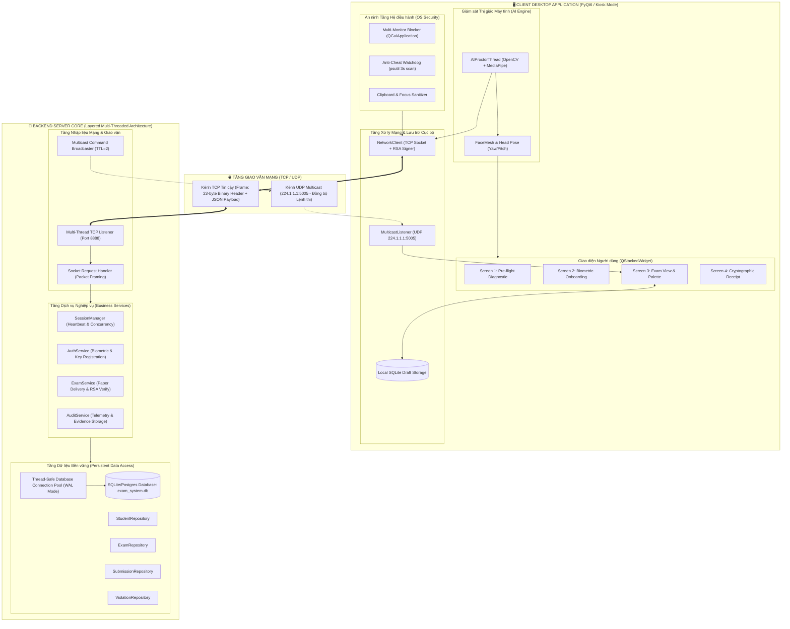
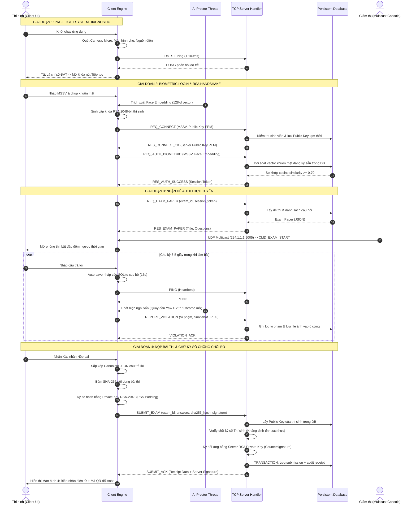
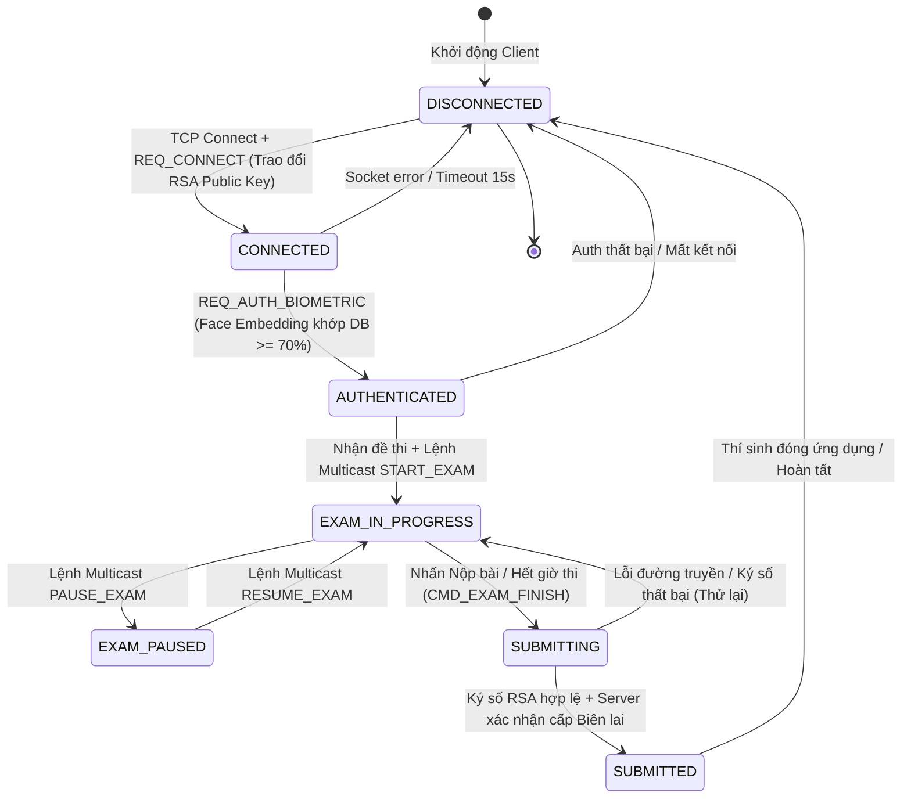

# TÀI LIỆU KIẾN TRÚC HỆ THỐNG (SYSTEM ARCHITECTURE)
## Nền tảng Khảo thí Trực tuyến An toàn & Giám sát AI (Smart AI Proctoring & Secure Examination Platform)

---

### 1. TỔNG QUAN HỆ THỐNG
Hệ thống là nền tảng khảo thí phân tán chuẩn Client-Server dành cho môi trường mạng nội bộ (LAN/Enterprise), tích hợp giám sát sinh trắc học thời gian thực bằng AI, kiểm soát an ninh tầng hệ điều hành (Kiosk OS-level), đồng bộ hóa lệnh thi đồng loạt qua UDP Multicast, và bảo đảm tính toàn vẹn, chống chối bỏ (Non-repudiation) thông qua Chữ ký số RSA-2048 PSS kết hợp hàm băm an toàn SHA-256.

---

### 2. SƠ ĐỒ THÀNH PHẦN KIẾN TRÚC (SYSTEM COMPONENT DIAGRAM)

---

### 3. SƠ ĐỒ TUẦN TỰ ĐẦY ĐỦ VÒNG ĐỜI THI (SEQUENCE DIAGRAM)

---

### 4. MÔ HÌNH MÁY TRẠNG THÁI PHIÊN (SESSION STATE MACHINE)

#### Bảng Phân tích Chi tiết Trạng thái Phiên (Session State Transitions)

| Trạng thái | Điều kiện kích hoạt (Trigger) | Hành động Hệ thống (Actions) | Quyền hạn Thí sinh | Rủi ro & Cơ chế phục hồi (Fail-safe) |
|---|---|---|---|---|
| **DISCONNECTED** | Mở ứng dụng hoặc mất kết nối vật lý | Client thử kết nối lại TCP mỗi 4 giây | Chỉ chạy Pre-flight Diagnostics | Không cho phép vào thi nếu chưa nối mạng |
| **CONNECTED** | Hoàn tất bắt tay TCP và gửi `REQ_CONNECT` | Lưu tạm Session, trao đổi khóa công khai RSA-2048 giữa 2 bên | Điền form MSSV, căn chỉnh camera | Timeout 15s tự hủy kết nối để chống nghẽn |
| **AUTHENTICATED** | So khớp Face Embedding đạt độ tin cậy >= 70% | Sinh Session Token, lưu trạng thái định danh vào DB | Được yêu cầu tải đề thi | Nếu sai khuôn mặt quá 3 lần -> Báo động |
| **EXAM_IN_PROGRESS** | Tải đề xong và nhận lệnh bắt đầu | Khởi động luồng giám sát AI, nhận heartbeat định kỳ, bắt đầu đếm giờ | Trả lời câu hỏi, chuyển câu trên Palette | Nếu đứt kết nối mạng: Auto-save SQLite cục bộ không đóng băng màn hình, tự kết nối lại |
| **EXAM_PAUSED** | Nhận lệnh `CMD_EXAM_PAUSE` qua UDP Multicast | Dừng bộ đếm ngược, vô hiệu hóa ô nhập liệu tạm thời | Chỉ xem câu hỏi, không sửa được bài | Phục hồi ngay khi nhận `CMD_EXAM_RESUME` |
| **SUBMITTING** | Thí sinh xác nhận nộp hoặc hết giờ | Canonical hóa đáp án, băm SHA-256, ký RSA-2048 PSS | Khóa mọi ô nhập liệu | Có cơ chế retry nếu gói tin gửi đi bị thất lạc |
| **SUBMITTED** | Server verify chữ ký số và ghi DB thành công | Xóa bản nháp SQLite cục bộ, tạo mã QR biên lai | Xem chứng chỉ biên lai, quét QR | Biên lai lưu bất biến trên Server DB chống chối bỏ |
