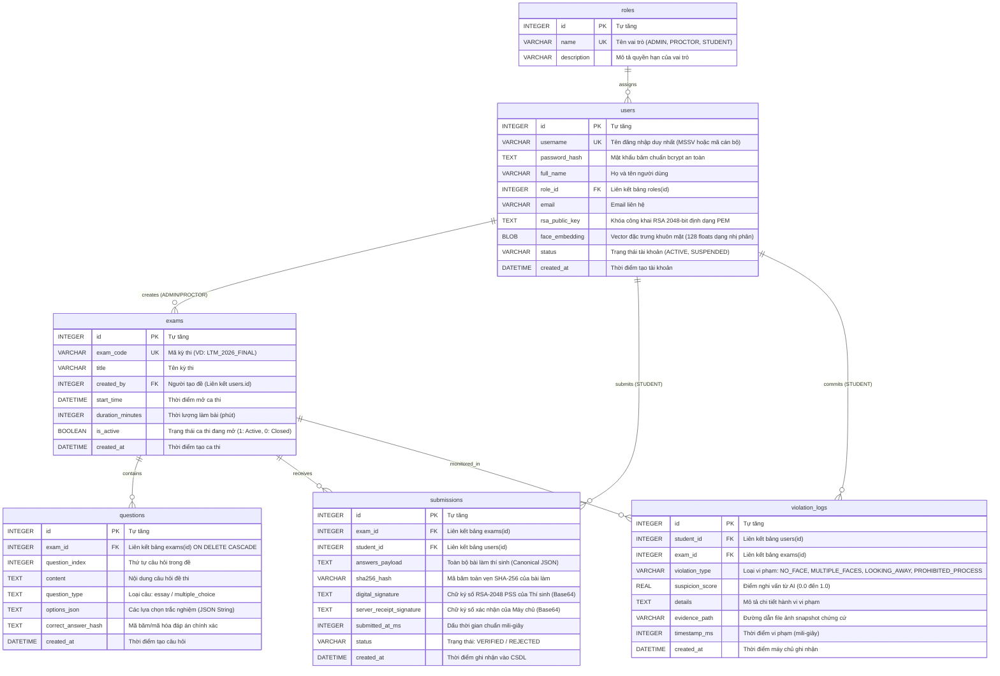

# THIẾT KẾ CƠ SỞ DỮ LIỆU BỀN VỮNG (DATABASE DESIGN SPECIFICATION)
## Nền tảng Khảo thí Trực tuyến An toàn & Giám sát AI (Persistent Storage Engine)

---

### 1. TỔNG QUAN & MỤC TIÊU
Tầng cơ sở dữ liệu (Database Layer) chịu trách nhiệm lưu trữ bền vững toàn bộ dữ liệu nghiệp vụ của kỳ thi, bao gồm:
- Hồ sơ sinh viên, vector sinh trắc học khuôn mặt (Face Embedding 128 chiều) và Khóa công khai RSA-2048 để đối soát chữ ký số.
- Ngân hàng đề thi và danh sách câu hỏi tự luận/trắc nghiệm có mã hóa.
- Nhật ký vi phạm thời gian thực kèm đường dẫn chứng cứ ảnh chụp từ AI Proctoring.
- Bản ghi nộp bài thi bảo đảm tính bất biến, toàn vẹn dữ liệu (SHA-256) và tính pháp lý chống chối bỏ (Non-repudiation) qua Chữ ký số kép (Candidate Digital Signature + Server Countersignature).

Hệ thống hỗ trợ chuẩn SQLite đa luồng (WAL mode) cho môi trường thi gọn nhẹ, độc lập và tương thích cấu trúc với PostgreSQL khi mở rộng quy mô lớn.

---

### 2. SƠ ĐỒ THỰC THỂ QUAN HỆ (ERD - ENTITY RELATIONSHIP DIAGRAM)

---

### 3. ĐẶC TẢ CHI TIẾT CÁC BẢNG DỮ LIỆU (DATA DICTIONARY)

#### 3.1. Bảng `roles` (Vai trò & Phân quyền RBAC)
Lưu trữ danh mục vai trò người dùng trong hệ thống thi.

| Cột | Kiểu dữ liệu | Ràng buộc (Constraints) | Mô tả |
|---|---|---|---|
| `id` | `INTEGER` | PRIMARY KEY AUTOINCREMENT | Khóa chính tự tăng |
| `name` | `VARCHAR(32)` | NOT NULL, UNIQUE | Tên vai trò: `ADMIN`, `PROCTOR`, `STUDENT` |
| `description` | `VARCHAR(255)` | NULLABLE | Mô tả quyền hạn của vai trò |

#### 3.2. Bảng `users` (Tài khoản Người dùng Đa vai trò)
Thay thế và mở rộng bảng `students` cũ, hỗ trợ xác thực bằng mật khẩu băm bcrypt, sinh trắc học và khóa công khai RSA.

| Cột | Kiểu dữ liệu | Ràng buộc (Constraints) | Mô tả |
|---|---|---|---|
| `id` | `INTEGER` | PRIMARY KEY AUTOINCREMENT | Khóa chính tự tăng |
| `username` | `VARCHAR(64)` | NOT NULL, UNIQUE | Tên đăng nhập duy nhất (MSSV hoặc mã cán bộ) |
| `password_hash` | `TEXT` | NOT NULL | Mật khẩu băm chuẩn bcrypt an toàn |
| `full_name` | `VARCHAR(128)` | NOT NULL | Họ và tên người dùng |
| `role_id` | `INTEGER` | NOT NULL, FK `roles(id)` | Khóa ngoại xác định vai trò người dùng |
| `email` | `VARCHAR(128)` | NULLABLE | Địa chỉ email liên hệ |
| `rsa_public_key`| `TEXT` | NULLABLE | Khóa công khai RSA-2048 (PEM format) trao đổi khi kết nối |
| `face_embedding`| `BLOB` | NULLABLE | Vector 128 số thực biểu diễn đặc trưng khuôn mặt đã đăng ký |
| `status` | `VARCHAR(32)` | NOT NULL DEFAULT 'ACTIVE' | Trạng thái tài khoản: `ACTIVE`, `SUSPENDED` |
| `created_at` | `DATETIME` | DEFAULT CURRENT_TIMESTAMP | Thời điểm tạo tài khoản |

#### 3.3. Bảng `exams` (Ca thi & Đề thi)
Quản lý các ca thi, thời lượng, trạng thái kích hoạt đề thi và người khởi tạo đề.

| Cột | Kiểu dữ liệu | Ràng buộc (Constraints) | Mô tả |
|---|---|---|---|
| `id` | `INTEGER` | PRIMARY KEY AUTOINCREMENT | Khóa chính ca thi |
| `exam_code` | `VARCHAR(64)` | NOT NULL, UNIQUE | Mã định danh đề thi (VD: `LTM_2026_FINAL`) |
| `title` | `VARCHAR(255)` | NOT NULL | Tiêu đề kỳ thi |
| `created_by` | `INTEGER` | NULLABLE, FK `users(id)` | Cán bộ / Giảng viên tạo đề thi |
| `start_time` | `DATETIME` | DEFAULT CURRENT_TIMESTAMP | Giờ mở phòng thi |
| `duration_minutes` | `INTEGER` | NOT NULL DEFAULT 60 | Thời lượng làm bài tính bằng phút |
| `is_active` | `BOOLEAN` | NOT NULL DEFAULT 1 | 1 nếu đang cho phép thi, 0 nếu đã đóng |
| `created_at` | `DATETIME` | DEFAULT CURRENT_TIMESTAMP | Thời điểm tạo ca thi |

#### 3.4. Bảng `questions` (Chi tiết Câu hỏi trong Đề)
Lưu danh sách câu hỏi thuộc từng đề thi, hỗ trợ cả tự luận (essay) và trắc nghiệm.

| Cột | Kiểu dữ liệu | Ràng buộc (Constraints) | Mô tả |
|---|---|---|---|
| `id` | `INTEGER` | PRIMARY KEY AUTOINCREMENT | Khóa chính câu hỏi |
| `exam_id` | `INTEGER` | NOT NULL, FK `exams(id)` ON DELETE CASCADE | Ca thi sở hữu câu hỏi |
| `question_index` | `INTEGER` | NOT NULL | Số thứ tự câu hỏi (Câu 1, Câu 2,...) |
| `content` | `TEXT` | NOT NULL | Nội dung câu hỏi đề thi |
| `question_type` | `VARCHAR(32)` | DEFAULT 'essay' | Kiểu câu hỏi: `essay` hoặc `multiple_choice` |
| `options_json` | `TEXT` | NULLABLE | Danh sách đáp án A, B, C, D (JSON format) |
| `correct_answer_hash` | `TEXT` | NULLABLE | Hash SHA-256 của đáp án đúng để chấm tự động |
| `created_at` | `DATETIME` | DEFAULT CURRENT_TIMESTAMP | Thời điểm tạo câu hỏi |

#### 3.5. Bảng `submissions` (Bài nộp & Chữ ký số Chống chối bỏ)
Bảng quan trọng nhất ghi nhận bài làm cuối cùng. Đảm bảo tính pháp lý thông qua mã băm và chữ ký kép.

| Cột | Kiểu dữ liệu | Ràng buộc (Constraints) | Mô tả |
|---|---|---|---|
| `id` | `INTEGER` | PRIMARY KEY AUTOINCREMENT | Khóa chính bài nộp |
| `exam_id` | `INTEGER` | NOT NULL, FK `exams(id)` | Khóa ngoại tới đề thi |
| `student_id` | `INTEGER` | NOT NULL, FK `users(id)` | Khóa ngoại tới thí sinh nộp bài (`users.id`) |
| `answers_payload`| `TEXT` | NOT NULL | Toàn bộ câu trả lời (JSON định dạng chuẩn hóa) |
| `sha256_hash` | `VARCHAR(64)` | NOT NULL | Giá trị băm SHA-256 của `answers_payload` |
| `digital_signature` | `TEXT` | NOT NULL | Chữ ký số RSA-2048 PSS của thí sinh |
| `server_receipt_signature` | `TEXT` | NOT NULL | Chữ ký số đối ứng của Máy chủ xác nhận biên lai |
| `submitted_at_ms` | `INTEGER` | NOT NULL | Thời gian nộp chuẩn mili-giây |
| `status` | `VARCHAR(32)` | DEFAULT 'VERIFIED' | Trạng thái kiểm tra: `VERIFIED` hoặc `REJECTED` |
| `created_at` | `DATETIME` | DEFAULT CURRENT_TIMESTAMP | Thời điểm ghi DB |

#### 3.6. Bảng `violation_logs` (Nhật ký Giám sát An ninh AI)
Ghi nhận mọi sự kiện vi phạm hoặc hành vi đáng ngờ được phát hiện từ phía Client.

| Cột | Kiểu dữ liệu | Ràng buộc (Constraints) | Mô tả |
|---|---|---|---|
| `id` | `INTEGER` | PRIMARY KEY AUTOINCREMENT | Khóa chính vi phạm |
| `student_id` | `INTEGER` | NOT NULL, FK `users(id)` | Khóa ngoại tới thí sinh vi phạm (`users.id`) |
| `exam_id` | `INTEGER` | NOT NULL, FK `exams(id)` | Ca thi xảy ra vi phạm |
| `violation_type` | `VARCHAR(64)` | NOT NULL | Mã vi phạm (`LOOKING_AWAY`, `PROHIBITED_PROCESS`,...) |
| `suspicion_score` | `REAL` | DEFAULT 1.0 | Điểm nghi vấn từ 0.0 đến 1.0 |
| `details` | `TEXT` | NULLABLE | Mô tả chi tiết tiến trình vi phạm hoặc góc quay đầu |
| `evidence_path` | `VARCHAR(255)` | NULLABLE | Đường dẫn lưu ảnh bằng chứng JPEG trên máy chủ |
| `timestamp_ms` | `INTEGER` | NOT NULL | Thời điểm xảy ra vi phạm (mili-giây) |
| `created_at` | `DATETIME` | DEFAULT CURRENT_TIMESTAMP | Thời điểm máy chủ ghi nhận |

---

### 4. CHIẾN LƯỢC ĐÁNH CHỈ MỤC & TỐI ƯU HIỆU NĂNG (INDEXING STRATEGY)

Để đảm bảo máy chủ phản hồi trong vòng < 5ms ngay cả khi có hàng trăm kết nối đồng thời:
1. `idx_users_username` trên `users(username)`: Tăng tốc đăng nhập và đối soát thông tin tài khoản.
2. `idx_users_role_id` trên `users(role_id)`: Phân loại nhanh danh sách theo vai trò (ADMIN, PROCTOR, STUDENT).
3. `idx_exams_exam_code` trên `exams(exam_code)`: Tăng tốc tìm kiếm ca thi đang mở.
4. `idx_exams_created_by` trên `exams(created_by)`: Tối ưu tra cứu ca thi do cán bộ tạo.
5. `idx_questions_exam_id` trên `questions(exam_id, question_index)`: Lấy toàn bộ đề thi được sắp xếp chuẩn xác chỉ bằng 1 câu truy vấn index scan.
6. `idx_submissions_student_exam` trên `submissions(student_id, exam_id)`: Ràng buộc mỗi thí sinh chỉ có 1 bài nộp chính thức hợp lệ cho 1 đề thi.
7. `idx_violations_student_exam` trên `violation_logs(student_id, exam_id, timestamp_ms)`: Tối ưu cho dashboard giám thị lọc nhật ký vi phạm theo từng thí sinh theo trình tự thời gian.

---

### 5. KIẾN TRÚC TRUY CẬP ĐA LUỒNG AN TOÀN (CONCURRENCY SAFETY)

- **Chế độ WAL (Write-Ahead Logging):** Kích hoạt `PRAGMA journal_mode=WAL;`. Chế độ này cho phép nhiều luồng đọc (Readers) thực hiện đồng thời mà không bị chặn bởi luồng ghi (Writer).
- **Busy Timeout:** Kích hoạt `PRAGMA busy_timeout=5000;`. Khi có luồng đang thực hiện Transaction ghi, các luồng khác sẽ chờ tối đa 5000ms thay vì văng lỗi `SQLITE_BUSY`.
- **Thread-Local Connection Isolation:** Mỗi luồng xử lý socket (`Client-Handler Thread`) sở hữu một kết nối `sqlite3.Connection` riêng biệt thông qua `threading.local()`, tránh hoàn toàn lỗi chia sẻ socket/connection giữa các luồng trong Python.
- **Write Transaction Serialization Lock:** Sử dụng `threading.Lock()` bao quanh các tác vụ ghi nhạy cảm (Ghi bài thi, lưu biên lai) nhằm bảo đảm tính ACID và ngăn ngừa race condition tuyệt đối.
